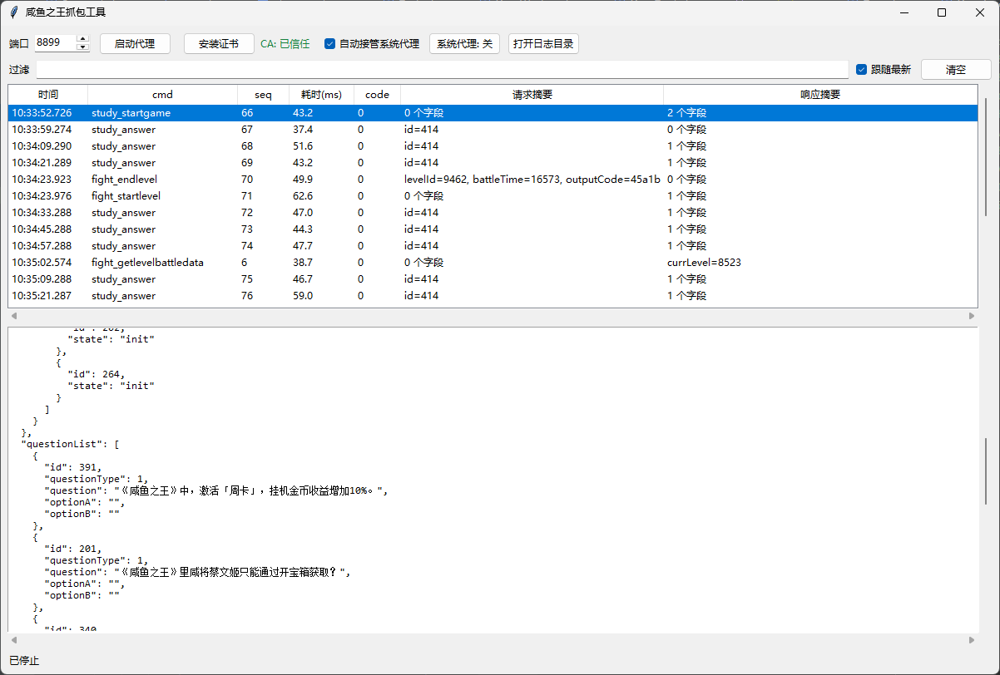

# 咸鱼之王抓包工具

实时抓取并解析《咸鱼之王》客户端的 WebSocket 通信，自动解密为 JSON，请求与响应自动配对，便于查看与分析。

> 非官方工具，仅供学习研究使用。使用前请阅读 [免责声明](#免责声明)。

[下载最新版](../../releases/latest) · Windows 10/11 64 位

## 功能

- 实时解析数据包，请求与响应自动配对
- 表格总览 + 完整 JSON 详情，支持关键字过滤
- 内置证书安装与系统代理开关，退出时自动恢复
- 抓包结果可导出为 JSONL 日志

## 使用

1. 下载并运行 `xyzw-proxy.exe`
2. 点击「启动代理」
3. 首次使用点击「安装证书」，无需管理员权限
4. 点击「系统代理」接管
5. 启动游戏，列表会实时显示数据

## 常见问题

**列表没有数据？** 确认 CA 状态为「已信任」、系统代理为「开」，然后重启游戏客户端。

**端口被占用？** 修改端口后重新启动，并关闭其他代理工具的系统代理。

**如何卸载？** 关闭程序后删除程序文件与 `logs` 目录；证书可在 `certmgr.msc` 的「受信任的根证书颁发机构」中删除 `mitmproxy`。

**杀毒软件报错？** 自解压程序存在误报可能，请仅从本仓库 Releases 下载并添加信任。

## 打赏

请作者喝杯咖啡吧~

  
  

## 免责声明

本工具为个人学习与研究用途，与游戏开发商、发行商无任何关联，也不代表其立场。工具仅在本机进行代理与流量解析，不修改游戏数据、不提供外挂功能，抓包数据仅保存在本机。

使用本工具可能违反游戏用户协议，存在账号受限或封禁的风险，相关后果由使用者自行承担。严禁将本工具用于商业或非法用途。本软件按「现状」提供，作者不对使用本工具造成的任何损失承担责任。

下载或使用即表示你已阅读并同意上述内容，完整条款见 [LICENSE](LICENSE)。
